<div align="center">

```
 _  __    _     _____  __  __     _
| |/ /   / \   |__  / |  \/  |   / \
| ' /   / _ \    / /  | |\/| |  / _ \
| . \  / ___ \  / /_  | |  | | / ___ \
|_|\_\/_/   \_\/____| |_|  |_|/_/   \_\
```

**Олдскульный системный набор инструментов для Windows, целиком в ASCII**

[](https://github.com/hhasanguclu/kazma/releases/latest)
[](https://github.com/hhasanguclu/kazma/actions)
[](LICENSE)


[English](README.md) · [Türkçe](README.tr.md) · [简体中文](README.zh-CN.md) · [繁體中文](README.zh-TW.md) · [日本語](README.ja.md) · [한국어](README.ko.md) · [Deutsch](README.de.md) · [Français](README.fr.md) · [Polski](README.pl.md) · [Українська](README.uk.md) · **Русский**

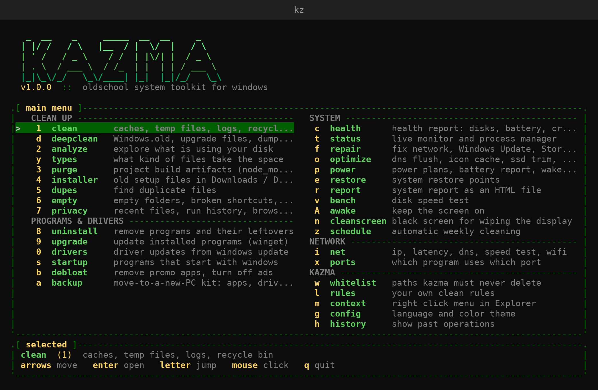 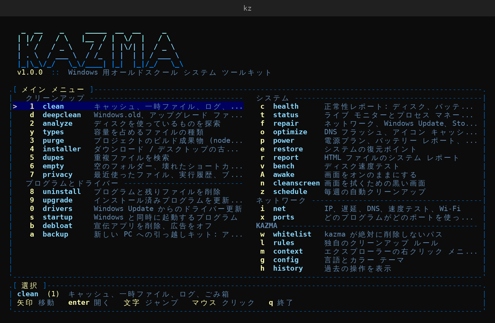

</div>

---

**kazma** (по-турецки *кирка*) — это один файл `kz.exe` размером около 2,7 MB, который очищает, исследует и
обслуживает ПК с Windows прямо из терминала, в ретро-стиле зелёного экрана. Без установщика, без фоновых служб,
без телеметрии. Интерфейс доступен на 11 языках (English, Türkçe, 简体中文, 繁體中文, 日本語, 한국어, Deutsch, Français, Polski,
Українська, Русский) и запускается на языке интерфейса Windows; сменить его можно командой `kz config lang de`.

## Возможности

| | |
|---|---|
| **Очистка** | более 100 видов кэшей, временных файлов, журналов и Корзина, включая ИИ-инструменты, игровые лаунчеры и остатки видеодрайверов (`clean`) · Windows.old, файлы обновления, дампы памяти, файл гибернации, старые точки восстановления (`deepclean`) · обзор диска с картой (treemap) и списком самых больших файлов (`analyze`) · типы файлов (`types`) · артефакты сборки проектов (`purge`) · старые установщики (`installer`) · дубликаты файлов (`dupes`) · пустые папки и битые ярлыки (`empty`) · следы работы (`privacy`) |
| **Программы и драйверы** | удаление программ и их остатков (`uninstall`) · обновление программ через winget (`upgrade`) · обновления драйверов из Центра обновления Windows (`drivers`) · приложения в автозагрузке (`startup`) · рекламные приложения и реклама Windows (`debloat`) · резервная копия для переезда на новый ПК (`backup`) |
| **Система** | отчёт о состоянии (`health`) · монитор в реальном времени с GPU и батареей, диспетчер процессов, который объясняет, зачем запущен процесс (`status`) · обслуживание: DNS, кэш значков, SSD TRIM, DISM, SFC (`optimize`) · исправления: сеть, Центр обновления Windows, Store, системные файлы (`repair`) · схемы питания и батарея (`power`) · точки восстановления (`restore`) · HTML-отчёт (`report`) · тест скорости диска (`bench`) · автоматическая очистка (`schedule`) |
| **Сеть** | IP, задержка, тест и смена DNS, тест скорости, сохранённые сети Wi-Fi (`net`) · кто занимает какой порт (`ports`) |
| **Полезное** | какая программа держит файл открытым (`lock`) · не давать экрану гаснуть (`awake`) · режим для протирки экрана (`cleanscreen`) |
| **kazma** | защищённые пути (`whitelist`) · свои правила очистки (`rules`) · контекстное меню Проводника (`context`) · язык и тема (`config`) · самообновление (`update`) · журнал (`history`) · удаление kazma (`remove`) |

В каждом списке есть поиск по `/` и поддержка мыши (клик — выбрать, повторный клик — открыть, колесо — прокрутка).
Меню сообщает, когда выходит новая версия.

Он быстрый. При запуске от имени администратора на диске NTFS `analyze` и `types` читают главную таблицу файлов
(MFT) напрямую (тот же приём, что у WizTree), поэтому размеры всего диска готовы за секунды. В остальных случаях
размеры считаются параллельно, а `dupes` сравнивает файлы сначала по размеру, затем по первым и последним
64 KB и только потом хэширует целые файлы с помощью BLAKE3 (83 000 файлов / 5,9 GB примерно за 7 секунд).

## Установка

Windows 10/11, x64 и ARM64. Права администратора не нужны.

```powershell
iwr -useb https://raw.githubusercontent.com/hhasanguclu/kazma/main/install.ps1 | iex
```

Программа устанавливается в `%LOCALAPPDATA%\Programs\kazma`, а `kz` добавляется в PATH. Другие способы:

- **Scoop**: `scoop bucket add kazma https://github.com/hhasanguclu/kazma`, затем `scoop install kazma`
- **winget**: манифесты для каждого релиза генерируются в [`packaging/winget`](packaging/winget); после их принятия: `winget install hhasanguclu.kazma`
- **Вручную**: скачайте `kz.exe` из [последнего релиза](https://github.com/hhasanguclu/kazma/releases/latest)

> exe-файл пока не подписан, поэтому SmartScreen может показать предупреждение: **Подробнее -> Выполнить в любом случае**.
> Подпись через SignPath уже подготовлена, см. [docs/SIGNING.md](docs/SIGNING.md).

**Удаление**: `kz remove` (удаляет exe, его запись в PATH и `%LOCALAPPDATA%\kazma`).

## Команды

| Команда | Что делает |
|---|---|
| `kz` | Интерактивное меню |
| `kz clean` | Временные файлы, аварийные дампы, кэши браузеров / приложений / инструментов разработки, Корзина |
| `kz deepclean` | Windows.old, установочные файлы обновлений, ESD-файлы, дампы памяти, файл гибернации, старые точки восстановления (админ) |
| `kz analyze [path]` | Обзор занятого места на диске: `t` карта, `b` самые большие файлы, `s` сортировка, `/` поиск, `w` кто занимает; объясняет особые файлы (hiberfil, диски WSL, резервные копии iPhone...); удалённое отправляется в Корзину |
| `kz types [path]` | Какие типы файлов занимают место (видео, изображения, архивы...) и самые частые расширения |
| `kz purge [paths...]` | Артефакты сборки: `node_modules`, `target`, `bin/obj`, `.venv`, `__pycache__`, ... |
| `kz installer [paths...]` | Старые установщики (`.exe`, `.msi`, `.msix`, `.iso`) в Загрузках и на Рабочем столе |
| `kz dupes [paths...]` | Дубликаты файлов (размер -> частичный хэш -> BLAKE3, всё параллельно) |
| `kz empty [paths...]` | Пустые папки, битые ярлыки и файлы 0 байт (в Корзину) |
| `kz privacy` | Недавние файлы, история «Выполнить» / Проводника, буфер обмена, история и cookie браузеров (по выбору) |
| `kz uninstall` | Удаление классических приложений, приложений Microsoft Store и Scoop, а затем оставшихся папок и ключей реестра (с предварительной резервной копией); `--leftovers` находит остатки приложений, удалённых другим способом |
| `kz upgrade` | Обновление установленных программ через winget |
| `kz drivers` | Обновления драйверов из Центра обновления Windows; `--installed` показывает сторонние драйверы по возрасту |
| `kz startup` | Включение и отключение приложений в автозагрузке (те же флаги, что в Диспетчере задач, полностью обратимо) |
| `kz debloat` | Удаление предустановленных рекламных приложений по фиксированному списку, отключение рекламы; `--restore` всё возвращает |
| `kz backup [folder]` | Набор для нового ПК: список приложений winget, драйверы, список программ, настройки kazma; `kz backup restore FOLDER` всё переустанавливает |
| `kz health` | SMART дисков, износ батареи, синие экраны, ошибки, обновления, Defender, брандмауэр |
| `kz status` | CPU, GPU, память, диск, сеть, батарея в реальном времени; `enter` объясняет, зачем запущен процесс, `x` завершает его, `m` сортирует по памяти |
| `kz power` | Схемы питания (`set saver / balanced / high / ultimate`), отчёт `battery`, источники пробуждения `wake`, `hibernate off / reduced / full` |
| `kz restore` | Точки восстановления системы: `list`, `create "desc"`, `enable`, `open` (мастер самой Windows) |
| `kz report` | HTML-отчёт о системе: оборудование, состояние, автозагрузка, программы, драйверы |
| `kz bench [path]` | Тест скорости диска: последовательный и 4K случайный доступ, в обход кэша ОС |
| `kz net` | IP и задержка; тест `dns`, `dns set cloudflare`; тест скорости `speed`; `wifi [--show]` |
| `kz ports [filter]` | Какая программа слушает какой порт; `--kill PORT` закрывает её |
| `kz optimize` | Битые элементы автозагрузки (с резервной копией), перезапуск Пуска и поиска, сброс DNS, кэш значков, SSD TRIM / DISM / SFC по необходимости |
| `kz repair [fix]` | `network`, `update` (сброс Центра обновления Windows), `store`, `dism` (+SFC), `time`, `printer`; сначала создаётся точка восстановления (админ) |
| `kz schedule weekly` | Автоматический запуск `kz clean --yes` (`daily`, `weekly`, `monthly`, `off`, `status`) |
| `kz lock <path>` | Какая программа держит открытым файл или папку |
| `kz awake [minutes]` | Не давать экрану и ПК засыпать |
| `kz cleanscreen [seconds]` | Чёрный экран, игнорирующий ввод, чтобы протереть дисплей |
| `kz whitelist` | Пути, которые kazma никогда не удалит (`--add`, `--remove`, `--edit`) |
| `kz rules` | Свои правила очистки для `kz clean` (`--edit` открывает Блокнот) |
| `kz context install` | Пункт «Analyze with kazma» в контекстном меню Проводника (`uninstall` убирает его) |
| `kz config` | `kz config lang de` (auto, en, tr, zh-CN, zh-TW, ja, ko, de, fr, pl, uk, ru), `kz config theme amber` (green, amber, white, blue) |
| `kz update` | Обновление самого kazma с GitHub (с проверкой контрольной суммы) |
| `kz history` | Журнал всего, что сделал kazma |
| `kz remove` | Удаление kazma |

Каждая команда, которая что-то удаляет или устанавливает, поддерживает `--dry-run` (`-n`) для предварительного просмотра.
Запускайте из терминала **с правами администратора** (Запуск от имени администратора), чтобы устанавливать драйверы,
выполнять задачи обслуживания для администратора и очищать кэши Центра обновления Windows и системные временные файлы.

## Безопасность

- `clean` трогает только известные кэши и временные папки, которые восстанавливаются сами; временные файлы моложе 24 ч остаются.
- `purge` удаляет папку только тогда, когда рядом с ней лежит маркер проекта (`package.json`, `Cargo.toml`, `.csproj`...).
- Корни дисков, ваш профиль, `Windows`, `Program Files`, `AppData` и подобные папки жёстко заблокированы.
- Удалённое в `analyze`, `installer`, `dupes` и остатки после `uninstall` отправляются в **Корзину**.
- `dupes` всегда оставляет хотя бы один файл из каждой группы.
- `drivers` устанавливает только драйверы, предложенные **Центром обновления Windows**, и сначала создаёт **точку восстановления**.
- `startup` лишь переключает флаги вкл/выкл Диспетчера задач; `debloat` удаляет только приложения из фиксированного списка, а `--restore` отменяет его настройки.
- `update` проверяет загруженный файл по `SHA256SUMS.txt` из релиза.
- `deepclean` удаляет Windows.old и файлы обновления через встроенную Очистку диска Windows и всегда сохраняет самую новую точку восстановления.
- `repair` переименовывает папки Центра обновления Windows, а не удаляет их, и сначала предлагает создать точку восстановления.
- Модуль чтения MFT только читает диск и никогда ничего на него не записывает.
- Остатки в реестре и битые элементы автозагрузки перед удалением экспортируются в `%LOCALAPPDATA%\kazma\backups`.
- Предложения `uninstall --leftovers` изначально не выбраны и отправляются в Корзину.
- **Белый список**: пути из `%LOCALAPPDATA%\kazma\whitelist.txt` никогда не удаляются. Если файл существует, но не читается, kazma отказывается работать.
- Каждое действие записывается в журнал (`kz history`); без терминала ничего не удаляется, если не передан `--yes`.

## Сборка

```bash
cargo build --release                                  # on Windows -> target\release\kz.exe
rustup target add x86_64-pc-windows-gnu                # cross-compile from Linux
sudo apt install gcc-mingw-w64-x86-64
cargo build --release --target x86_64-pc-windows-gnu
```

Для разработки код собирается и на Linux/macOS; части, работающие только в Windows, закрыты `cfg(windows)`.
Чтобы выпустить релиз, увеличьте `version` в `Cargo.toml` и отправьте изменения в `main`: CI тестирует на Windows,
по-настоящему запускает все команды, работающие только на чтение, затем публикует `vX.Y.Z` с `kz.exe`, zip-архивом и
`SHA256SUMS.txt` и обновляет манифесты Scoop / winget.

## Скриншоты

| | |
|---|---|
| **`kz`** · English<br> | **`kz`** · 日本語<br> |
| **`kz`** · Türkçe<br>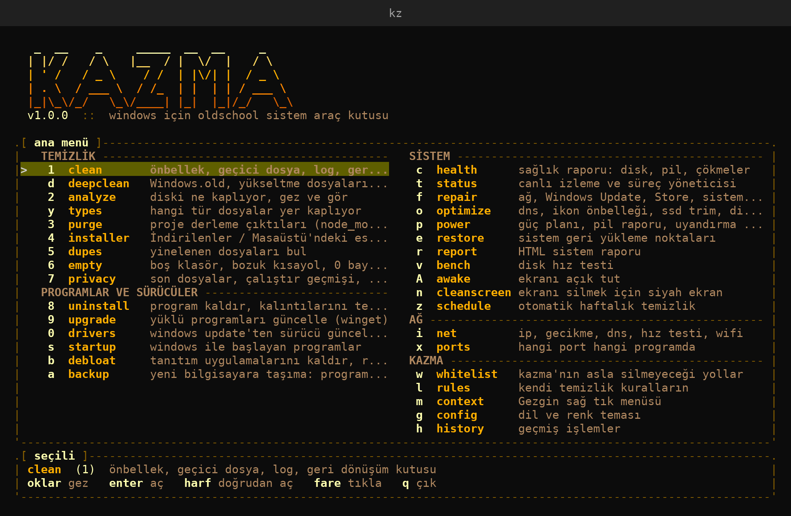 | **`kz analyze`** · `(i)`<br>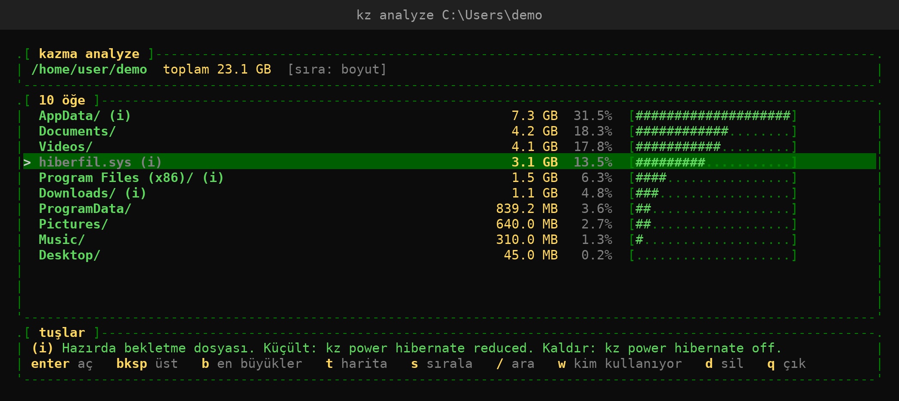 |
| **`kz analyze`** + `b`<br>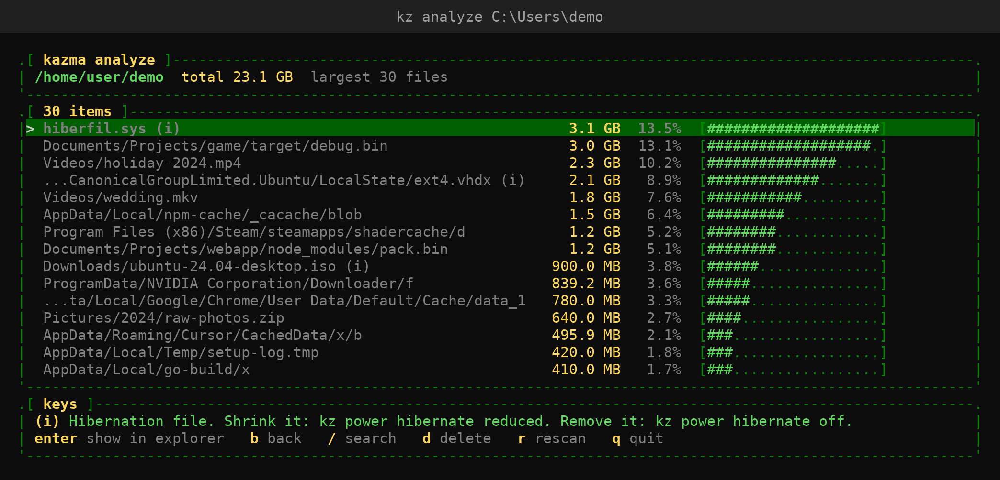 | **`kz analyze`** + `t`<br>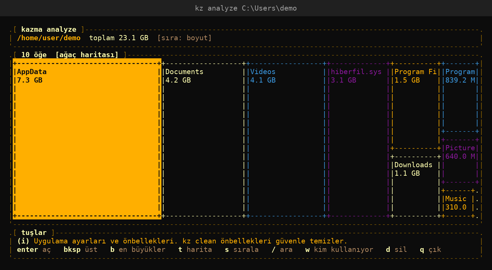 |
| **`kz clean`** · Türkçe<br>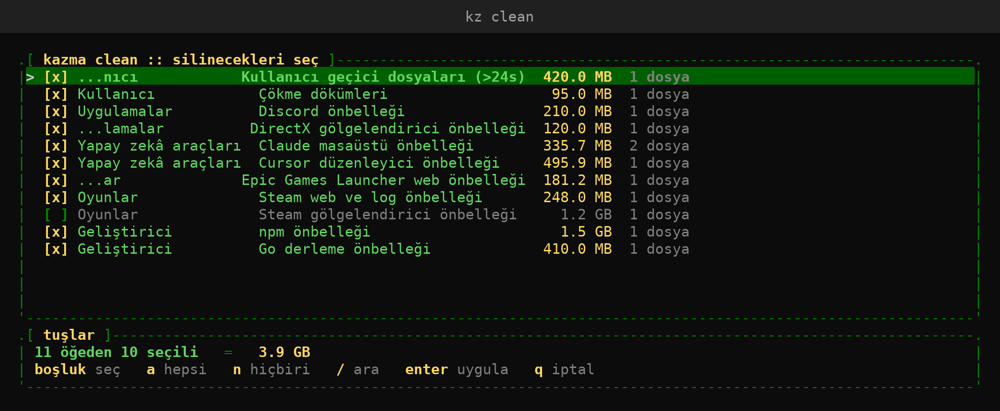 | **`kz clean`** · Deutsch<br>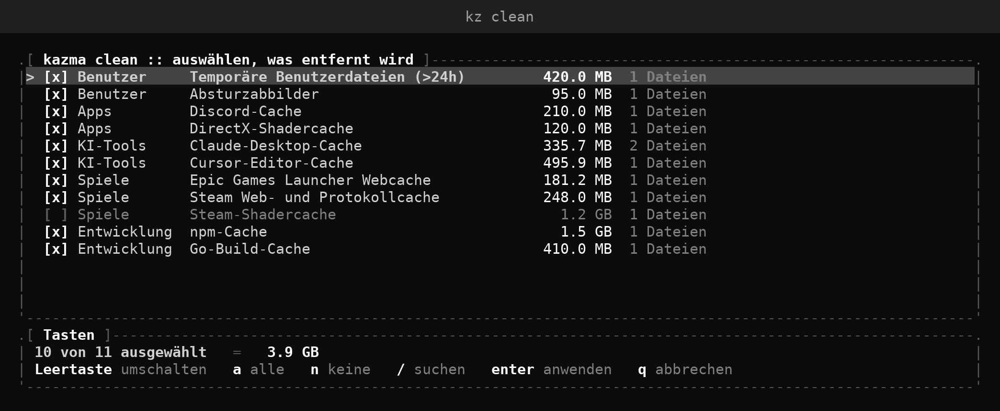 |
| **`kz types`**<br>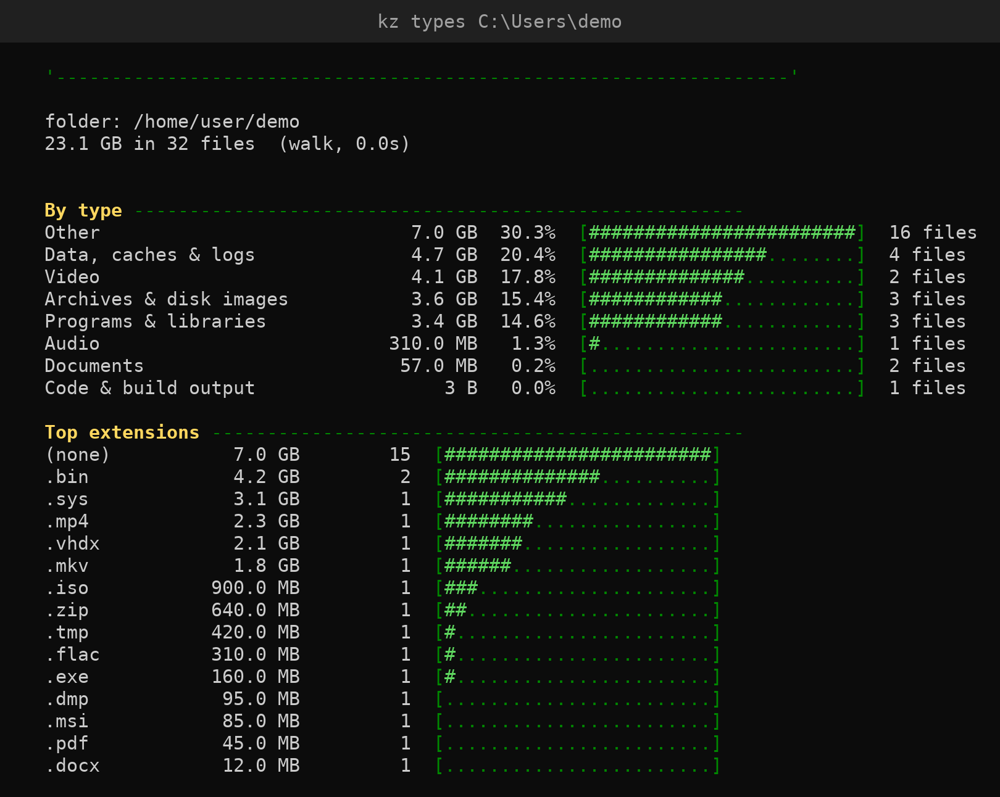 | **`kz purge`**<br>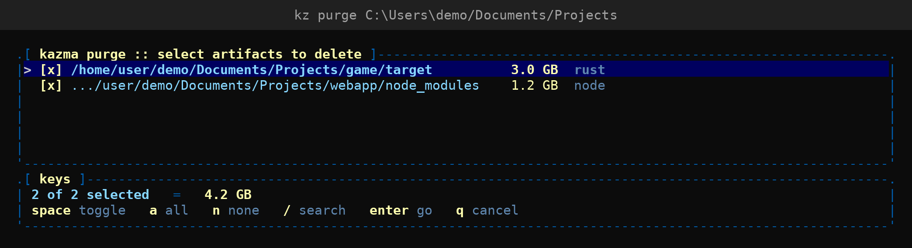 |
| **`kz health`** · Windows<br>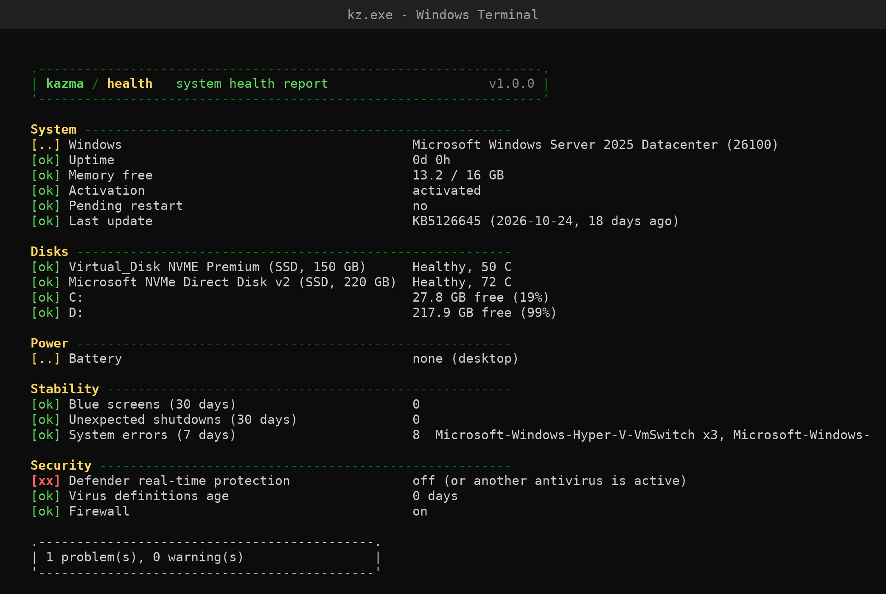 | **`kz health`** · Windows · 日本語<br>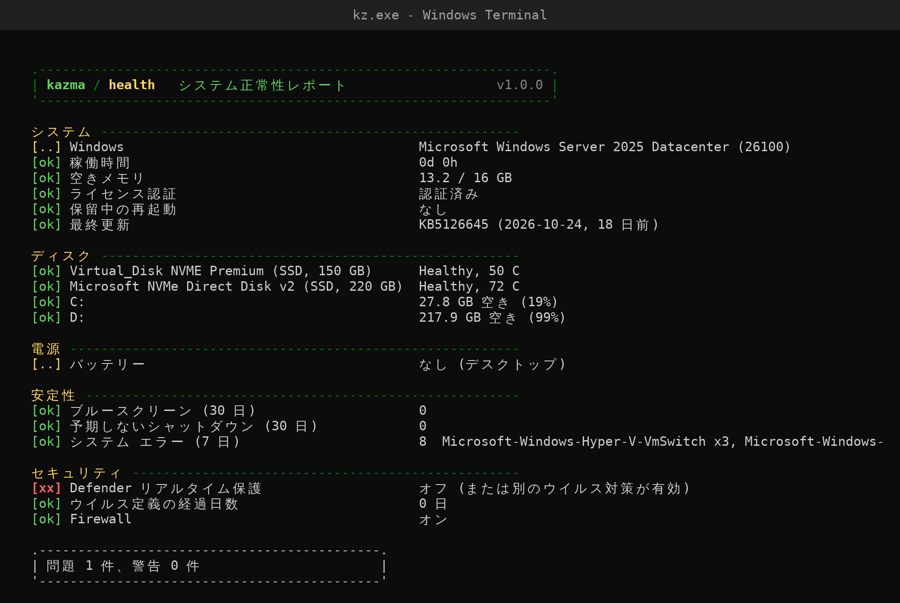 |
| **`kz startup --list`** · Windows<br>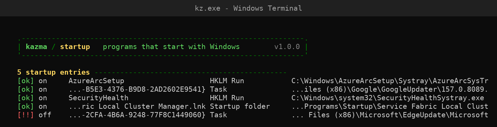 |  |

<sub>`health` и `startup` сняты при реальном запуске в Windows (GitHub Actions, Windows Server 2025).
Остальные экраны получены из того же кода, запущенного в терминале с демонстрационными данными, поэтому пути
в них выглядят как `/home/user/demo`.</sub>

## Благодарности

**Вдохновение.** kazma вдохновлён проектом [Mole](https://github.com/tw93/Mole) от
[tw93](https://github.com/tw93) — набором для глубокой очистки macOS. kazma написан с нуля на Rust и
не использует его код.

**Переводы.** Все языки, кроме английского и турецкого, хранятся в [`locales/`](locales) в виде JSON-файлов,
которые сопоставляют английский текст с переводом. Исправления очень приветствуются: отредактируйте файл и откройте pull request
(`python tools/i18n_extract.py --missing de` показывает, чего ещё не хватает в языке).

**Библиотеки.** Спасибо авторам и сопровождающим:

| Крейт | Для чего | Лицензия |
|---|---|---|
| [ratatui](https://github.com/ratatui/ratatui) | интерфейс терминала | MIT |
| [crossterm](https://github.com/crossterm-rs/crossterm) | ввод и цвета в терминале | MIT |
| [clap](https://github.com/clap-rs/clap) | командная строка | MIT / Apache-2.0 |
| [sysinfo](https://github.com/GuillaumeGomez/sysinfo) | CPU, память, диски, процессы | MIT |
| [rayon](https://github.com/rayon-rs/rayon) | параллельное сканирование | MIT / Apache-2.0 |
| [BLAKE3](https://github.com/BLAKE3-team/BLAKE3) | хэширование дубликатов | CC0 / Apache-2.0 |
| [trash](https://github.com/Byron/trash-rs) | Корзина | MIT |
| [serde](https://github.com/serde-rs/serde), [serde_json](https://github.com/serde-rs/json) | JSON из PowerShell, переводы | MIT / Apache-2.0 |
| [anyhow](https://github.com/dtolnay/anyhow) | ошибки | MIT / Apache-2.0 |
| [syn](https://github.com/dtolnay/syn), [quote](https://github.com/dtolnay/quote) | макрос перевода `tr!` | MIT / Apache-2.0 |
| [windows-sys](https://github.com/microsoft/windows-rs) | Windows API | MIT / Apache-2.0 |
| [winresource](https://github.com/BenjaminRi/winresource) | значок и сведения о версии exe | MIT |

**Платформа.** [winget](https://github.com/microsoft/winget-cli) от Microsoft (обновление программ), Windows Update
Agent API (обновление драйверов), [Scoop](https://scoop.sh) (распространение) и
[SignPath Foundation](https://signpath.org) (бесплатная подпись кода для открытого ПО).

**Оформление.** Баннер набран классическим шрифтом [FIGlet](http://www.figlet.org) «standard»; скриншоты
отрисованы шрифтом [DejaVu Sans Mono](https://dejavu-fonts.github.io).

**Автор.** [hhasanguclu](https://github.com/hhasanguclu). Сообщения об ошибках, идеи и pull request'ы приветствуются.

## Лицензия

[MIT](LICENSE)
